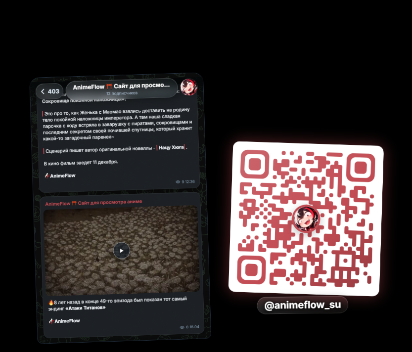
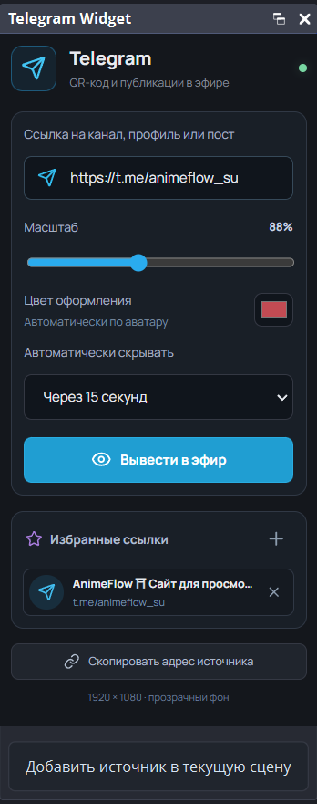

<a name="tw-top"></a>

<div align="center">
  
  <h1>Telegram Widget</h1>
  <p><strong>Ваш Telegram — часть эфира.</strong></p>
  <p>Каналы, публикации и QR-код с управлением прямо в OBS Studio.</p>
  <p></p>
  <p>
    <a href="#tw-install"></a>
    <a href="#tw-usage"></a>
    <a href="#tw-build"></a>
    <a href="#tw-help"></a>
  </p>
</div>

---

Плагин выводит в эфир Telegram-канал, профиль или отдельную публикацию вместе с QR-кодом. Вставьте ссылку в док-панель, выберите оформление и нажмите **«Вывести в эфир»**. Внешний сервер не нужен: управление и показ работают через локальную службу на вашем компьютере.

## Как это выглядит

<table>
  <tr>
    <th>В эфире</th>
    <th>В панели OBS</th>
  </tr>
  <tr>
    <td align="center" valign="middle"></td>
    <td align="center" valign="top"></td>
  </tr>
</table>

## Возможности

- QR-код со ссылкой, аватаром и именем Telegram-канала или профиля.
- Просмотр публичных публикаций: текст, изображения и видео, доступные в предпросмотре Telegram.
- Плавное появление, скрытие и замена одного виджета другим.
- Изменение масштаба от 45 до 150% прямо во время показа.
- Автоматический цвет по аватару или свой цвет оформления.
- Автоматическое скрытие через 15, 30, 60 или 120 секунд либо ручное управление.
- Избранные ссылки и горячие клавиши.
- Сохранение ссылки, настроек и избранного между запусками OBS.

## Требования

- Windows x64 и OBS Studio с компонентом «Браузер». Запуск плагина проверен на OBS **32.2.2**.
- Доступ к Telegram с компьютера стримера для загрузки каналов, публикаций и медиа.

Готовых сборок для Linux и macOS пока нет.

<a name="tw-install"></a>

## Установка

Нужен **готовый ZIP с плагином**, а не архив исходного кода. Финальная сборка в этом проекте находится в `package/TelegramWidget-0.1.0-Windows-x64-Final.zip`. Сборочные архивы не хранятся в Git и распространяются отдельно.

> [!IMPORTANT]
> Копируйте обе папки — `data` и `obs-plugins`. Одной DLL недостаточно для работы плагина.

1. Полностью закройте OBS, в том числе тестовые копии.
2. Распакуйте ZIP. Откройте папку, в которой лежат `data`, `obs-plugins` и `Install.ps1`.
3. Скопируйте **обе папки `data` и `obs-plugins`** в корень установленной OBS. Стандартный путь:

   ```text
   C:\Program Files\obs-studio
   ```

4. Объедините содержимое с существующими папками. При обновлении подтвердите замену файлов плагина и запрос прав администратора.
5. Запустите OBS и откройте **«Док-панели → Telegram Widget»**.

Папки копируются именно в `obs-studio`, **не в `bin\64bit`**. Не удаляйте существующие папки OBS перед копированием.

Если OBS установлена в другой каталог, используйте его вместо стандартного пути.

<a name="tw-usage"></a>

## Как пользоваться

1. Выберите сцену, в которой хотите показывать виджет.
2. Внизу панели Telegram Widget нажмите **«Добавить источник в текущую сцену»**. Появится прозрачный браузерный источник размером 1920 × 1080, подогнанный под холст сцены.
3. Вставьте ссылку на канал, профиль или публикацию. Например:

   ```text
   https://t.me/animeflow_su
   @animeflow_su
   https://t.me/animeflow_su/403
   ```

4. Настройте масштаб, цвет и время автоматического скрытия.
5. Нажмите **«Вывести в эфир»**.

Во время показа та же кнопка меняется на **«Скрыть»**. Чтобы показать другой канал или пост, измените ссылку и нажмите **«Заменить в эфире»**: старый виджет плавно скроется, затем появится новый.

После перезапуска OBS настройки сохраняются, но сам виджет остаётся скрытым до следующего показа.

### Панель управления

**Масштаб и цвет** применяются к уже показанному виджету. После ручного выбора цвета кнопка сброса рядом с ним возвращает автоматический подбор по аватару.

**Избранное:** вставьте ссылку и нажмите `+` в блоке «Избранные ссылки». Нажатие на сохранённый элемент подставляет ссылку в поле; затем нажмите кнопку показа. Крестик удаляет ссылку из избранного.

**Горячие клавиши:** откройте **«Настройки → Горячие клавиши»** и найдите команды `Telegram Widget: Show`, `Telegram Widget: Hide` и `Telegram Widget: Show/Hide`.

Кнопка **«Скопировать адрес источника»** нужна, если вы хотите добавить браузерный источник вручную. Обычно достаточно кнопки добавления источника внизу панели.

## Важно знать

- Поддерживаются публичные Telegram-ссылки. Закрытые каналы, приватные приглашения и публикации, требующие входа, не поддерживаются.
- Виджет использует публичный предпросмотр Telegram. Длинные статьи могут быть сокращены, а недоступное в предпросмотре содержимое не появится и в OBS.
- Локальная служба запускается и останавливается вместе с плагином. Вручную запускать сервер не нужно.
- Одновременно может работать только один экземпляр службы: он использует локальный порт `45871`. Перед запуском тестовой OBS закройте рабочую.

> [!WARNING]
> Не публикуйте скопированный адрес источника: в нём находится ключ доступа к локальному виджету.

<a name="tw-help"></a>

## Если что-то не работает

**Нет пункта Telegram Widget в меню док-панелей.** Проверьте путь `obs-plugins\64bit\telegram-widget.dll` внутри каталога OBS и перезапустите OBS. Убедитесь, что используете Windows x64 и совместимую версию OBS.

**Панель пишет, что локальный виджет остановился.** Установите полный актуальный пакет, а не только DLL. Проверьте наличие `data\obs-plugins\telegram-widget\runtime\node.exe` и `data\obs-plugins\telegram-widget\service\main.js`. Закройте второй экземпляр OBS или отдельно запущенного виджета.

**Панель работает, но в эфире ничего нет.** Добавьте источник кнопкой внизу панели, проверьте его видимость в нужной сцене и нажмите «Вывести в эфир». Если страница не загружается, проверьте публичность ссылки и доступ к Telegram.

Подробная ошибка находится в **«Справка → Файлы журналов → Просмотреть текущий журнал»**. Сообщения плагина помечены `[Telegram Widget]`. Перед передачей полного журнала проверьте, нет ли в нём приватных адресов и токенов других источников.

## Обновление и настройки

Для обновления закройте OBS и скопируйте `data` и `obs-plugins` из нового полного пакета поверх старых файлов.

Настройки и кэш хранятся отдельно от установки, в `plugin_config\telegram-widget` внутри папки конфигурации OBS. В обычной установке Windows это `%APPDATA%\obs-studio\plugin_config\telegram-widget`; у portable-версии конфигурация находится рядом с самой OBS.

<a name="tw-build"></a>

## Для разработчиков

### Полная сборка Windows x64

В папке проекта запустите:

```powershell
.\Build.cmd
```

Сценарий подготовит SDK OBS, Qt, CMake и Node.js, выполнит тесты и создаст дистрибутив в `package/`. При отсутствии Visual Studio 2022 C++ Build Tools и Windows SDK он запросит согласие на их установку. Первичная подготовка требует интернета и нескольких гигабайт свободного места.

Сборка сама не устанавливает плагин в рабочую OBS и не меняет StreamOverlay. Логи находятся в `build/logs/`, путь к созданному архиву после сборки — в `package/last-build-zip.txt`.

Для проверки готового пакета без установки в рабочую OBS запустите `Test.cmd`. Он создаст отдельную portable-копию в `build/obs-test`. Нужна распакованная последняя сборка с её метаданными либо единственный готовый ZIP в `package/`.

### Разработка интерфейса и службы

Нужны Node.js 22.15+ и npm. Команды выполняются из папки проекта:

```powershell
npm ci
npm test
npm run build
npm start
```

Служба напечатает локальные адреса панели и источника. В этом режиме она запускается вручную; установленный плагин запускает её автоматически. Не запускайте этот режим одновременно с плагином в OBS.

Исходники находятся в `native/`, `frontend/` и `service/`; тесты — в `test/`, сценарии сборки — в `scripts/`. Каталоги `build/`, `dist/`, `node_modules/` и `package/` генерируются локально и исключены из Git.

## Лицензия

[GPL-2.0-or-later](LICENSE). Сторонние библиотеки сохраняют свои лицензии; уведомления входят в готовый пакет.

---

<p align="center"><a href="#tw-top">↑ Вернуться наверх</a></p>
